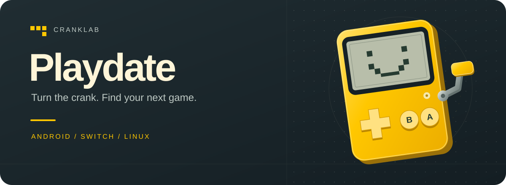
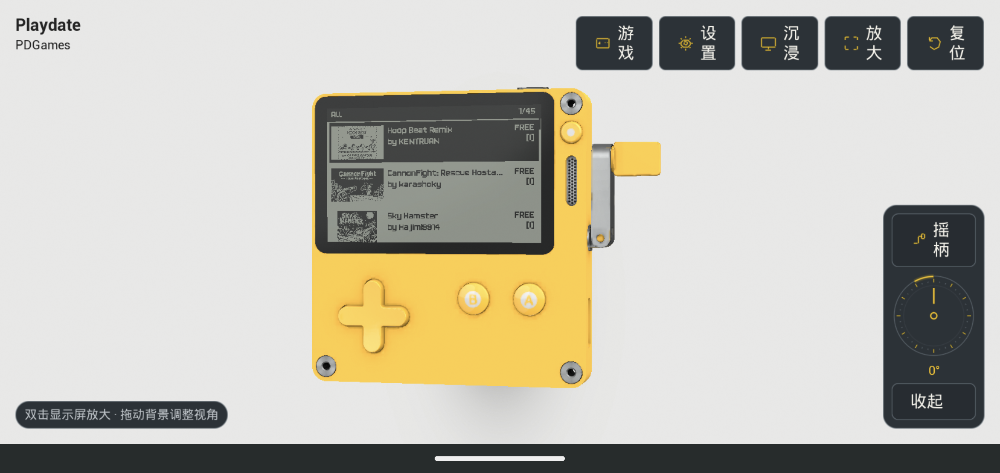
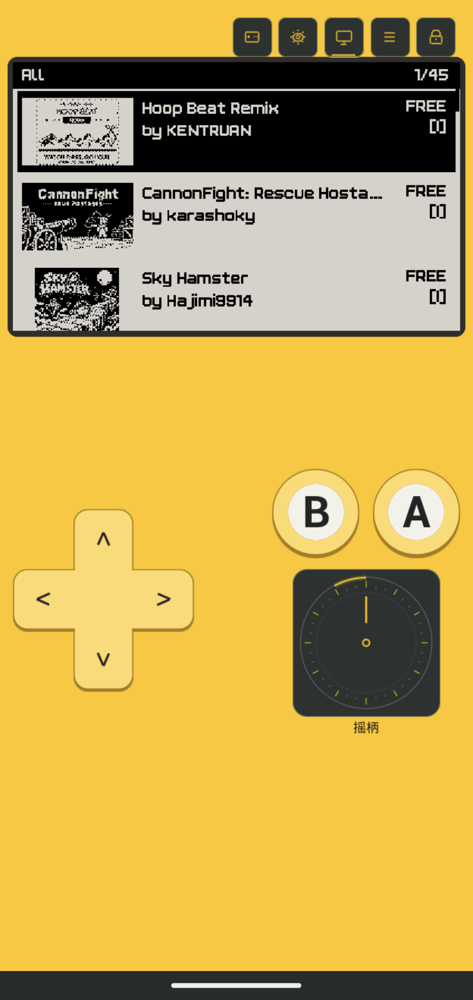
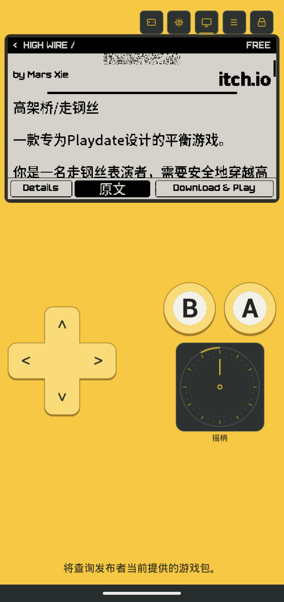

  

<h1 align="center">Playdate</h1>

  <strong>转动摇柄，发现下一款好玩的小游戏。</strong> 
  把黄色小掌机的乐趣，带到你的手机和掌机上。

  <a href="https://github.com/dodola/cranklab/releases/tag/v0.3.0-beta.1"><strong>下载 Beta</strong></a>
  &nbsp; · &nbsp;
  <a href="#在-android-上这样玩">体验亮点</a>
  &nbsp; · &nbsp;
  <a href="#选择你的设备">选择设备</a>

Playdate（CrankLab）是一个社区开发的 Playdate 兼容项目。喜欢摆弄掌机，就打开 3D 视图；想专心玩游戏，就切换到沉浸式模式。也可以在 Switch 或 Linux 掌机上，用熟悉的实体按键继续游玩。

## 在 Android 上这样玩

- **一台看得见、摸得着的 3D 掌机。** 拖动背景调整视角，双击显示屏放大；开启视角跟随后，掌机会随手机倾斜轻轻转动。
- **让游戏占据更多屏幕。** 沉浸式模式放大游戏画面、方向键和 A/B 按钮，横屏、竖屏都能玩。
- **摇柄就在指尖。** 拖动摇柄转盘，或在沉浸式画面上上下滑动，体验 Playdate 独特的操作方式。
- **从发现到开玩。** 默认打开 PDGames，在游戏详情里浏览介绍、下载发布者提供的游戏包，安装后直接运行；也支持导入本地游戏。
- **游戏介绍，直接读中文。** 在详情页切换中文与原文，译文自动缓存。可以使用在线翻译，也可以选择本地翻译。
- **按你的习惯调整。** 视角跟随、操作震动、画面品质与帧率，都可以在设置中调整。

## 界面预览

  
   3D 掌机 · PDGames · 可操作的摇柄

  
  &nbsp; &nbsp;
  
   沉浸式游玩 · 直接阅读中文介绍

以上为 **v0.3.0-beta.1 在 Pixel 4 上的实际截图**。也可以查看 [横屏沉浸式界面](docs/assets/android-immersive-landscape.png)。

## 选择你的设备

当前版本：**[v0.3.0-beta.1](https://github.com/dodola/cranklab/releases/tag/v0.3.0-beta.1)**

| 设备 | 适合怎样玩 | 下载 |
|---|---|---|
| **Android 手机** | 3D 掌机、沉浸式触控、PDGames 与中文介绍；Android 8.0 及以上 ARM64 设备 | [Android APK](https://github.com/dodola/cranklab/releases/download/v0.3.0-beta.1/Playdate-v0.3.0-beta.1-arm64.apk) |
| **Switch / Lite / OLED** | 实体按键与摇杆摇柄、PDGames、本地游戏库；需要可运行自制程序的设备 | [Switch NRO](https://github.com/dodola/cranklab/releases/download/v0.3.0-beta.1/Playdate.nro) |
| **Linux 桌面与掌机** | 在 RetroArch 中游玩，使用实体按键与右摇杆 | [桌面 x86_64](https://github.com/dodola/cranklab/releases/download/v0.3.0-beta.1/CrankLab-libretro-linux-x86_64-v0.3.0-beta.1.zip) · [掌机 ARM64](https://github.com/dodola/cranklab/releases/download/v0.3.0-beta.1/CrankLab-libretro-linux-aarch64-v0.3.0-beta.1.zip) |

Android 版提供上面的完整界面体验；Switch 和 Linux 首版专注于 **Lua 游戏**，不包含 3D 掌机或翻译功能。Android 保留 C 游戏运行后端，但各平台的游戏兼容性都仍在持续完善。Switch 版目前尚未完成真机验证。

## 开始你的第一局

**Android：** 下载并安装 APK，打开应用后进入 PDGames。在游戏详情中选择下载／运行，也可以导入自己的游戏包。现有同签名版本可直接覆盖安装。

**Switch：** 将 `Playdate.nro` 放到 SD 卡的 `/switch/playdate/`，从 Homebrew Menu 启动。方向键与 A/B 操作游戏，右摇杆画圈或按住 ZR/ZL 转动摇柄。

**Linux：** 下载对应架构的压缩包，按包内说明将核心加入 RetroArch，再打开自己的游戏包。L/R 或右摇杆操作摇柄，Start 打开游戏菜单。

安装说明：[Android](https://github.com/dodola/cranklab/releases/download/v0.3.0-beta.1/README-Android.zh-CN.md) · [Switch](outputs/ue5-playdate/switch/README.md) · [RetroArch / Linux](outputs/ue5-playdate/libretro/README.md)

---

这是一个仍在成长中的 **Beta 社区项目**，并非官方模拟器。不同游戏的支持情况会有所差异，欢迎分享你正在玩的游戏、设备和使用体验。

想参与开发？[开发与构建](docs/DEVELOPMENT.md) · [翻译功能说明](outputs/ue5-playdate/translation/LOCAL-TRANSLATION.md) · [项目与素材来源](outputs/ue5-playdate/third-party.json)
